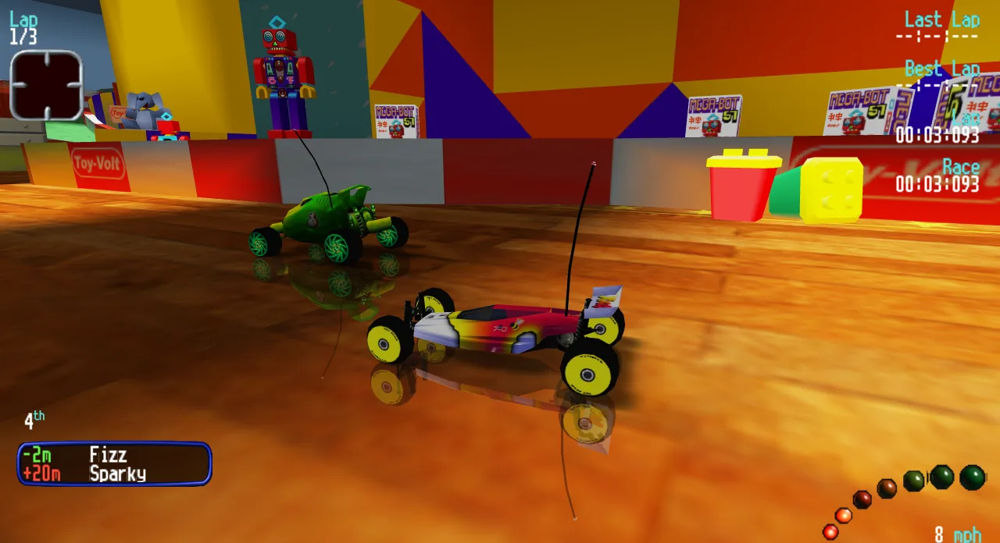
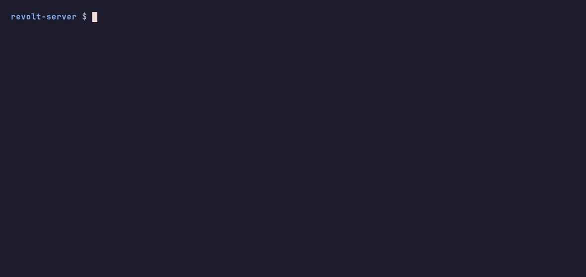

# Browser-based multiplayer for Re-Volt (1999) — from your own disc



## Quick start

Requirements: [Docker](https://docs.docker.com/get-docker/) — nothing else.

```bash
./start.sh /path/to/GAME.CUE ./game-data --public     # converts your game once, then starts the server
```



Once it is up, it prints a link:

```
  play and share:     https://lucky-river-garden-maple.trycloudflare.com    (example: yours will differ)
```

Open it yourself and send it to your friends: everyone plays at the same address, in a browser.
`--public` is what makes it (a free Cloudflare quick tunnel: no router setup, no account). It changes on
every start, so send the new one each time.

The tunnel carries only TCP, so players who come through it race over the web socket (a little more
jitter) unless UDP is reachable too. Without `--public`, `start.sh` prints your own addresses instead
(`http://localhost` on this computer, `http://192.168.1.20` on the local network, your public IP with
the ports forwarded on your router).

Stop it with `./stop.sh`.

## What it is

An unofficial browser racing engine and server: up to 16 players race in the browser, with
computer drivers filling the grid, all 13 tracks forwards / reversed / mirrored, the original cars,
weapons and pickups. Keyboard, gamepad or touch.

Built with [Box3D](https://github.com/erincatto/box3d) by Erin Catto for the physics (compiled to
WebAssembly, the same engine in the browser and on the server), [three.js](https://threejs.org) for the
graphics and [Bun](https://bun.sh) for the server.

It works with the data of **Re-Volt**, the 1999 PC racing game — an independent project, not affiliated
with or endorsed by the game's rights holders.

**No game files are included.** This repository holds only the new game's code and tools. You need your
own compatible game data (a PC disc image or an installed game). `start.sh` converts it on your machine and
starts a server for you and your friends.

## Your game data

The first argument to `start.sh` is your game, in any of these forms:
- a `.cue` with its `.bin` — includes the CD music
- a `.bin` / `.img` (raw CD image) or `.iso` — an `.iso` has no music unless a `.cue` + `.bin` sit next to it
- a folder: an installed game, a copied or mounted CD, or a folder with a disc image in it (also a
  folder or two down)
- an archive (`.7z`, `.zip`, `.rar`) holding any of these, as disc images are often downloaded — it is
  unpacked inside the container

The second is where the converted game goes (~100–150 MB). A second start with the same input skips the
conversion and takes seconds.

Checked with the French PC release (one `.bin` + `.cue`, and the `.iso` alone) and the US release as
preserved by Redump (a `.cue` with one `.bin` per track, as the `.7z`, unpacked and in a subfolder):
the same tracks, cars and textures come out of both.

## What it works out by itself

- **The kind of input**, by its contents (not its file name), and where the game's files are inside it.
- **Music**: from the CD audio tracks when a `.cue` is there; otherwise it says there is none.
- **Whether to convert**: the output folder remembers what it was made from.
- **Ports**: 80 and UDP 7903, or the next free ones.
- **Addresses**: the public address (asked from api.ipify.org) and the local network one, and whether
  you are behind a router.
- **Whether the fast UDP channel can be reached.** Without it the game still works over the web socket
  (TCP), with more jitter on other cars.

## Options

```
./start.sh <input> <output folder> [--rebuild] [--no-music] [--public] [--fg]
  --rebuild    convert again even if the output folder is up to date
  --no-music   leave the CD music out
  --public     an https address on the internet through a Cloudflare quick tunnel
  --fg         run in this terminal (Ctrl+C stops it) instead of in the background

PORT=8080 UDP_PORT=7910 ./start.sh …     other ports (the next free one is taken if busy)
PUBLIC_IP=… LAN_IP=…                      the addresses players connect to, if detected wrong
AI_RACERS=6                               computer drivers fill the grid up to this many cars
NAME=game-server-2                        a second server (with its own output folder); NAME=… ./stop.sh
```

The server runs in the background and restarts with Docker. Logs: `docker logs -f game-server`. With
`--public` the tunnel runs beside it as `game-server-tunnel`; if it restarts, its new address is in
`docker logs game-server-tunnel`.
Player laps that beat the computer drivers are kept in `<output folder>/laps/`.

In the game: `?offline` free practice without the server, `?car=<key>` start car, `?bot=1` self-driving
(testing).

## How it works

- `tool/Dockerfile` — one image: the game (Bun, three.js, Box3D physics compiled to WebAssembly), the
  converter (Python), 7-Zip and ffmpeg.
- `tool/prepare.py` — finds the game in the input, `convert/convert.py` turns the game's tracks, cars,
  textures, sounds and HUD into web files, ffmpeg makes the music (MP3) and the sound effects (Opus), and
  the computer drivers' training files (`src/public/game/*/ai-*.json`, part of this repository) are added.
- `src/server.ts` — serves the page and runs the lobby: vote for the next course, grid, 3 laps, results.
  Computer drivers are simulated on the server. Car states travel over a WebRTC data channel (UDP), the
  rest over a WebSocket.
- `tool/udpcheck.ts` — opens a data channel to the server through the published port, to check it.
- `--public` runs Cloudflare's `cloudflared` image as a quick tunnel to the server.

## Development

```bash
cd src && bun install && bun run build        # the page into src/dist
docker run --rm -v ./convert:/app:ro -v <game folder>:/rv:ro -v ./src/public/game:/out \
  python:3.12-slim python -I /app/convert.py   # one track: add its name (toylite, toy2, market1, …)
bun run server.ts                              # PORT=…, RTC_PORT=…, RTC_PUBLIC_IP=…
```

Headless tests (no browser) are in `src/test/` — e.g. `TRACK=toylite bun test/sim.ts rc bot 200` (one car)
and `bun test/race.ts toylite` (a whole computer race). The physics wasm is built from `wasm/shim.c` +
`box3d/` with the `emscripten/emsdk` image:

```bash
docker run --rm -v "$PWD":/p -w /p emscripten/emsdk:4.0.10 bash -c \
  "emcmake cmake -S wasm -B build-wasm -DCMAKE_BUILD_TYPE=Release && cmake --build build-wasm -j"
cp build-wasm/box3d.js src/src/box3d.js && cp build-wasm/box3d.wasm src/public/box3d.wasm
```

## Legal

The original game and its content belong to their respective rights holders. This repository does not
include the original game's asset files and is not affiliated with or endorsed by its rights holders.
Supply game data you are authorized to use; this project's licence does not grant rights to that content.

This is meant for players who own the game. A running server hands the converted game files to everyone
who opens it, so if you host one, you are responsible for who can reach it: keep it to your own network,
or to friends who own the game. A `--public` address can be opened by anyone who has it; share it only
with them.

This project's code: MIT licence (`LICENSE`). Box3D © Erin Catto, MIT licence (`box3d/LICENSE`).
